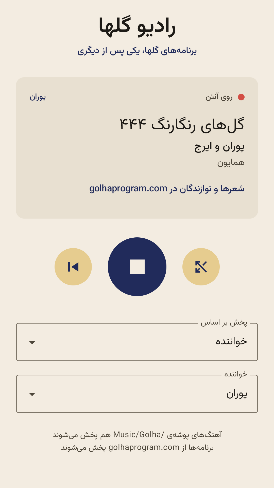
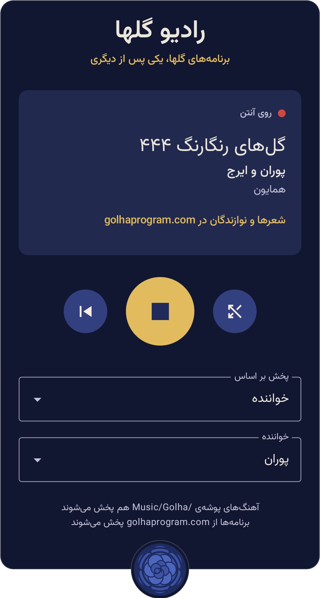

A small, personal Android app that plays the **Golha** programmes (گلها), the legendary series of Persian music and
poetry broadcast by Iranian National Radio from 1956 to 1979, like a radio: press play and it keeps going, one
programme after another, in random order and without repeats.

<table align="center">
  <tr>
    <td align="center">
      <br><br>
      
    </td>
    <td align="center">
      <br><br>
      
    </td>
  </tr>
</table>

## What it does

- **A radio, not a playlist.** Programmes are dealt from a shuffled deck; none repeats until all have played. After
  stopping and closing the app, it carries on in the same order, at the same second.
- **Stations.** Listen to everything, or to one singer (e.g. بنان، مرضیه، حسین قوامی), one dastgah (e.g. ماهور،
  دشتی، همایون) or one programme series. Pick with two dropdowns; each choice shows how many programmes it has.
- **Next and shuffle.** Next plays another random programme of the station; shuffle tunes to a random singer or
  dastgah station.
- **In Persian, right to left,** with Persian digits and names in Persian alphabetical order. Light and dark mode
  follow the phone, in its own wallpaper colours.
- **Plays in the background,** with the usual lock-screen, notification and Bluetooth headphone controls.
- **A link to each programme's page** on golhaprogram.com, with its poems, players and announcer.
- **Your own files too (optional).** Audio files in `Music/Golha/` on the phone join the stations through their
  tags (artist = singer, genre = dastgah, album = programme).
- **Nothing is downloaded or tracked.** Programmes stream on demand; the app keeps only its own running order on
  the phone.

## Where the programmes come from

The app streams **346 programmes of Golha-ye Rangarang (گل‌های رنگارنگ)** from
[golhaprogram.com](https://golhaprogram.com), a community archive that offers each programme to play and download.
The list (`app/src/main/assets/golhaprogram.json`) is built from the site's
[open-source programme data](https://github.com/golhaprogram/golhaprogram-website); see [CREDITS.md](CREDITS.md).

The [Golha Project](https://www.golha.co.uk) at SOAS holds the fuller archive, with more series (Golha-ye
Javidan, Barg-e Sabz, Yek Shakh-e Gol and others). Its site doesn't allow downloading or reuse, so the app doesn't
use it; we've written to ask for permission and will add it if they agree.

## Build and run

Needs a Mac with [Homebrew](https://brew.sh) and an Android phone (Android 13 or newer) on the same Wi-Fi.

```sh
make setup      # Java 17, Android command-line tools and SDK (all removable: make uninstall-tools)
make test       # unit tests (no phone needed)
make run        # build, install on the phone and open the app
```

The phone connects over Wi-Fi: turn on *Developer options → Wireless debugging*, pair once with
`adb pair <address>`, after which `adb devices` usually finds it by itself. (Building inside Docker was tried and
dropped: Google's Android build tools are x86-only, so on Apple Silicon they ran emulated, slowly, and ran out of
memory.)

To refresh the programme list from golhaprogram.com (e.g. when it adds programmes or series):

```sh
make golha-streams   # downloads the site's programme data, checks each MP3 exists, rewrites golhaprogram.json
```

## Project layout

| Path | What's there |
|---|---|
| `app/src/main/java/com/radiogolha/MainActivity.kt` | The screen (Jetpack Compose) |
| `app/src/main/java/com/radiogolha/PlaybackService.kt` | The player, running in the background (Media3) |
| `app/src/main/java/com/radiogolha/RadioQueue.kt` | The shuffled running order |
| `app/src/main/java/com/radiogolha/Station.kt` | Stations, Persian alphabetical order |
| `app/src/main/java/com/radiogolha/SongLibrary.kt` | Finds the programmes and files to play |
| `scripts/make_golha_streams.py` | Builds the programme list from golhaprogram.com's data |
| `scripts/make_icon.py` | Draws the app icon ([docs/ICON.md](docs/ICON.md)) |
| `scripts/make_test_songs.py` | Generates tagged test songs (`make test-songs`) |
| [IDEA.md](IDEA.md) | What the app is for, as first written down |

## To do

- [ ] Check by hand that the lock-screen and Bluetooth headphone buttons pause, resume and skip.
- [ ] Known gap: if Android kills the app while it's playing, it resumes at the start of that programme, not at
  the exact second.
- [ ] Add the Golha Project's archive (golha.co.uk) if they give permission; waiting for their reply.
- [ ] Ideas: fade between programmes; Android Auto (needs a browsable station list); a spoken intro before each
  programme ("Next, Banan in Dastgah-e Mahur").

## Status

A personal project for one Pixel 7, installed as a debug build over Wi-Fi; not on the Play Store.
