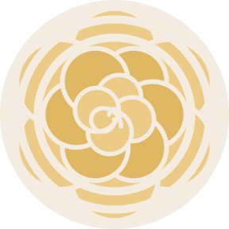
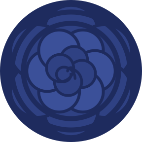

# The app icon

 

The word گلها ("flowers") over a rose seen from above. The tips of the petals are cut by two rings in the background
colour, like radio waves. The left picture is the icon the app uses ("paper"). The right one ("lapis") is the same
drawing in the other palette, kept in case we switch.

## How it's made

It's all drawn by one script, so the icon is code, not artwork to edit by hand:

```
python3 -m venv build/icon-venv && build/icon-venv/bin/pip install fonttools uharfbuzz   # once
build/icon-venv/bin/python -I scripts/make_icon.py build/fonts/Parastoo-Bold.ttf
```

Parastoo Bold comes from [github.com/rastikerdar/parastoo-font](https://github.com/rastikerdar/parastoo-font) (put it in
`build/fonts/`). Android icons can't use a font, so the script turns the word into outlines: HarfBuzz joins the
Persian letters the way they're written, and fontTools reads their shapes.

The script writes these files. Don't edit them by hand, because the next run overwrites them:

| File | What it is |
|---|---|
| `app/src/main/res/drawable/ic_launcher_foreground.xml` | The rose, the wave cuts and the word |
| `app/src/main/res/drawable/ic_launcher_monochrome.xml` | One-colour version for themed icons: the rose faint, the word solid |
| `app/src/main/res/values/ic_launcher.xml` | The four colours (background, rose, inner rose, word) |
| `app/src/main/res/mipmap-anydpi-v26/ic_launcher*.xml` | Puts the layers together as an adaptive icon |
| `docs/icon.svg`, `docs/icon-dark.svg` | The two palettes as pictures, cut to a circle like a Pixel shows them |

Then build and install as usual (`make run`).

## Changing it

All in `scripts/make_icon.py`:

- **Colours:** `PALETTES`, as `#AARRGGBB` in the order background, rose, inner rose, word. To use lapis for the app,
  swap which palette `colours("paper")` writes.
- **Waves:** `--waves wide` (the default: two rings at radius 21 and 26), `subtle` (thin, half-transparent) or
  `echo` (a smaller rose with arcs around it). The ring sizes are in `main()`.
- **The rose:** `rose()` gives three rings of round petals: how many, how far from the centre, how big, and how far
  each ring is turned.
- **The word:** `WORD`, and its size in `word_path()` (`size=28`, at most 54 wide). It's always centred by its ink,
  not its letter boxes.

The canvas is 108 × 108. Launchers show only the middle 72, cut to their own shape, and anything important should stay
within 33 of the centre.

## Light and dark mode

- **The icon stays paper** in both modes. The Pixel launcher draws an app's icon once and keeps that picture, so a
  night version would only show if the app happened to be installed at night.
- **Themed icons** (Wallpaper & style) are Android's way to follow the mode: the launcher recolours the monochrome
  layer. On this phone that applies on the home screen, not in the app drawer.
- **The launch screen** does follow the mode: cream by day (`res/values/splash.xml`), lapis at night
  (`res/values-night/splash.xml`). Those two colours are set by hand, not by the script; keep them in step with the
  palettes if the colours change.
- **The app's own colours** are the same lapis, gold and cream, in `MainActivity.kt` (`GolhaLight`, `GolhaDark`).

## Fonts

Parastoo and Vazirmatn are both by Saber Rastikerdar, under the SIL Open Font License 1.1. The icon holds only
Parastoo's letter shapes, not the font. See [CREDITS.md](../CREDITS.md).
